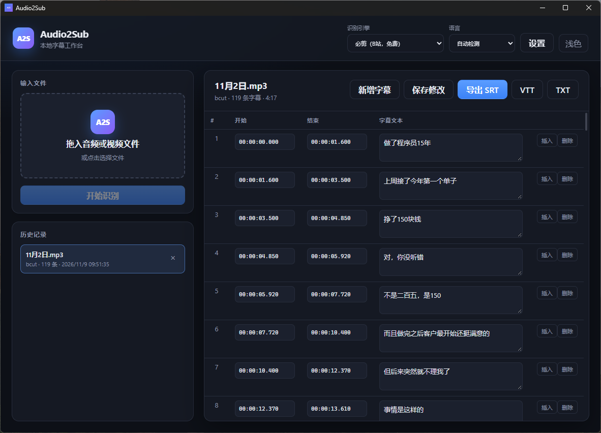

# Audio2Sub

基于 Rust + Tauri 2 的本地音频 / 视频转字幕桌面工具。

Audio2Sub 把本地媒体文件转换成 SRT、VTT 或 TXT 字幕。桌面端提供拖拽导入、识别进度、任务取消、字幕逐条编辑、时间码调整、历史记录和识别接口管理。命令行版本共用同一套 Rust 核心，适合批处理和自动化。

Windows 已完成本地运行验证；macOS / Linux 已纳入 CI 编译检查，运行时仍建议在对应系统实机验证。

## 界面预览



桌面端主界面：文件导入、引擎选择、字幕编辑与历史记录。

## 功能

- 音频 / 视频拖拽导入，支持 MP3、WAV、M4A、FLAC、OGG、MP4、MKV、MOV、WebM 等常见格式
- 必剪（B 站）免费识别引擎，无需账号和 API Key
- OpenAI 兼容接口：OpenAI、Groq、硅基流动，以及自定义 Base URL / 模型
- FFmpeg 自动提取音轨、探测时长
- 实时进度、阶段日志、任务取消
- 字幕表格编辑：文本、开始时间、结束时间、新增、插入、删除
- 导出 SRT、VTT、TXT
- SQLite 历史记录，支持重新打开和继续编辑
- API Key 存入系统凭据管理器，不写入项目文件
- 深色 / 浅色主题
- 启动时检测 ffmpeg / ffprobe，缺失时给出提示

## 识别引擎

| 引擎 | 认证 | 说明 |
|---|---|---|
| 必剪（B 站） | 无需账号、无需 API Key | 调用必剪网页接口，首次会匿名访问 B 站获取 WAF Cookie；非公开接口，稳定性无保证 |
| OpenAI | Bearer API Key | 官方 Whisper 接口 |
| Groq | Bearer API Key | OpenAI 兼容接口，免费额度较大，速度快 |
| 硅基流动 | Bearer API Key | OpenAI 兼容接口，支持 SenseVoice 等模型 |
| 自定义 | Bearer API Key | 任何兼容 `/audio/transcriptions` 的服务 |

必剪接口不需要登录 Token，但会使用匿名 Cookie 和单次任务的临时上传 / 任务 ID。该接口属于非官方接口，可能随时改版、限流或失效，请自行评估使用风险，并遵守 B 站相关服务条款。

## 与上游项目的关系

本项目在功能和接口流程上参考了：

- [yyzq-cf/ywsj-audio-to-subtitle](https://github.com/yyzq-cf/ywsj-audio-to-subtitle)

Audio2Sub 是独立的 Rust 实现，没有包含上游项目的 Python 代码、HTML / CSS / JavaScript、图片或其他资源。界面、图标、前端组件和 Rust 代码均为重新实现。上游仓库 README 声称 MIT，但仓库中没有 LICENSE 文件；如需复用上游代码或资源，请先与原作者确认授权。

## 技术栈

- 桌面框架：Tauri 2
- 前端：React 19 + TypeScript + Vite
- 核心逻辑：Rust
- 异步运行时：Tokio
- HTTP：reqwest
- 数据库：SQLite（rusqlite）
- 音视频处理：系统 FFmpeg / ffprobe
- API Key 存储：系统凭据管理器（keyring）

## 项目结构

```text
Audio2Sub/
├─ crates/
│  ├─ core/                 # 核心库：引擎、媒体、字幕、存储、任务流水线
│  └─ cli/                  # 命令行程序 audio2sub
├─ apps/
│  └─ desktop/
│     ├─ src/               # React 前端
│     └─ src-tauri/         # Tauri Rust 后端、窗口、命令、keyring
├─ docs/
│  └─ screenshots/
│     └─ main.png           # README 界面截图
├─ scripts/
│  ├─ test.ps1              # Windows 一键检查与测试
│  ├─ test.sh               # macOS / Linux 一键检查与测试
│  └─ publish-gitee.sh      # 同步 Release 到 Gitee
├─ .github/workflows/
│  ├─ ci.yml                # CI：Rust 测试、三平台桌面检查、前端构建
│  └─ release.yml           # 推送 v* 标签时构建安装包并发布 Release
├─ Cargo.toml               # Rust workspace（core + cli）
├─ Cargo.lock
├─ LICENSE
└─ README.md
```

桌面端是独立的 Tauri workspace，通过路径依赖使用 `crates/core`。根 workspace 不包含 `apps/desktop/src-tauri`，因此 `cargo test --workspace` 只测试核心库和 CLI，不会编译整个 Tauri / WebView 依赖树。

## 环境要求

通用要求：

- Rust stable
- Node.js 22+ 和 npm
- FFmpeg 与 ffprobe，且位于 `PATH` 中
- Tauri 2 构建依赖，参见 [Tauri prerequisites](https://tauri.app/start/prerequisites/)

Windows：

- Windows 10 / 11
- WebView2 Runtime
- MSVC Build Tools

macOS：

- Xcode Command Line Tools
- FFmpeg：`brew install ffmpeg`
- `.app` / `.dmg` 需要在 macOS 上构建；签名和公证需要 Apple 开发者账号

Linux：

- WebKitGTK 4.1、`libayatana-appindicator3-dev`、`librsvg2-dev`、`patchelf`
- keyring 编译依赖：`libdbus-1-dev`、`pkg-config`
- FFmpeg：`sudo apt install ffmpeg`
- API Key 存储依赖 Secret Service（GNOME Keyring / KWallet）；无桌面环境的服务器可能无法使用系统凭据管理器

检查 FFmpeg：

```bash
ffmpeg -version
ffprobe -version
```

如果使用自定义路径，可以设置：

```powershell
$env:AUDIO2SUB_FFMPEG = "D:\tools\ffmpeg\bin\ffmpeg.exe"
$env:AUDIO2SUB_FFPROBE = "D:\tools\ffmpeg\bin\ffprobe.exe"
```

```bash
export AUDIO2SUB_FFMPEG=/opt/ffmpeg/bin/ffmpeg
export AUDIO2SUB_FFPROBE=/opt/ffmpeg/bin/ffprobe
```

## 平台支持

| 平台 | 当前状态 | 典型产物 |
|---|---|---|
| Windows | 已本地验证 | MSI / NSIS |
| macOS | CI 编译检查，待实机验证 | `.app` / `.dmg` |
| Linux | CI 编译检查，待实机验证 | `.deb` / AppImage |

Tauri 不支持从 Windows 直接交叉编译 macOS / Linux 桌面安装包。请在各目标系统上构建，或使用 CI matrix。当前 CI 已配置 Windows、macOS、Ubuntu 三平台桌面编译检查。核心库和 CLI 是纯 Rust，可跨平台编译。

## 快速开始

### 桌面端开发

```powershell
cd apps\desktop
npm install
npx tauri dev
```

### 构建桌面程序

```powershell
cd apps\desktop
npx tauri build
```

Debug 版本可直接生成可执行文件：

```powershell
npx tauri build --debug --no-bundle
```

产物位于：

```text
apps\desktop\src-tauri\target\debug\audio2sub-desktop.exe
```

### 构建 CLI

```powershell
cargo build --release -p audio2sub-cli
```

产物：

```text
target\release\audio2sub.exe
```

## 发布安装包

### GitHub Actions 自动构建

仓库包含 `.github/workflows/release.yml`。推送 `v*` 标签时，会自动在 Windows、macOS、Linux 上构建安装包，并上传到对应的 GitHub Release：

```bash
git tag v0.1.0
git push origin v0.1.0
```

产物包括：

- Windows：`.msi` / `.exe`（NSIS）
- macOS：`.dmg` / `.app`
- Linux：`.deb` / `.AppImage`

构建产物会先作为 Actions artifacts 汇总，再由单独的 publish job 统一创建 Release，避免多平台并发时产生多个 draft。工作流默认创建 draft release，检查安装包无误后，在 GitHub 页面手动发布即可。

默认构建不包含代码签名。Windows 可能弹出 SmartScreen 提示，macOS 可能触发 Gatekeeper 拦截；正式发布建议配置 Windows 代码签名证书和 Apple Developer 签名 / 公证。

### Gitee

Gitee 不支持 GitHub Actions。可选方案：

1. 使用 Gitee Go 构建 Linux 安装包，但它不适合同时产出 Windows / macOS 安装包。
2. 推荐：由 GitHub Actions 构建，再把产物同步到 Gitee Release。仓库提供 `scripts/publish-gitee.sh`：

```bash
export GITEE_TOKEN="你的 Gitee 私人令牌"
export GITEE_OWNER="lonffrey1"
export GITEE_REPO="Audio2Sub"
bash scripts/publish-gitee.sh v0.1.0 artifacts/*
```

脚本会创建（或复用）对应 tag 的 Gitee Release，并上传安装包。Gitee 私人令牌需要 `projects` 权限；发布前请确认 Gitee Release 的单文件大小限制。

同时需要把代码和标签推送到 Gitee：

```bash
git remote add gitee https://gitee.com/lonffrey1/Audio2Sub.git
git push gitee master --tags
```

如果不想使用脚本，也可以在 Gitee 网页端手动创建 Release 并上传安装包。Gitee 上的源码仓库可以镜像 GitHub，但构建产物和 Release 附件需要单独同步。

## 命令行用法

必剪引擎：

```powershell
audio2sub transcribe "D:\media\meeting.mp4" --engine bcut --format srt
```

OpenAI 兼容接口：

```powershell
audio2sub transcribe "D:\media\audio.mp3" `
  --engine openai `
  --base-url "https://api.groq.com/openai/v1" `
  --api-key "你的 API Key" `
  --model "whisper-large-v3" `
  --language zh `
  --format srt
```

硅基流动示例：

```powershell
audio2sub transcribe "D:\media\audio.mp3" `
  --engine openai `
  --base-url "https://api.siliconflow.cn/v1" `
  --api-key "你的 API Key" `
  --model "FunAudioLLM/SenseVoiceSmall"
```

其他命令：

```powershell
audio2sub probe "D:\media\video.mp4"
audio2sub history --data-dir ".\data"
```

默认输出文件与输入文件同目录，扩展名由 `--format` 决定。CLI 默认数据目录为用户数据目录下的 `Audio2Sub`，可通过 `--data-dir` 或环境变量 `AUDIO2SUB_DATA_DIR` 指定。

### 支持的环境变量

| 变量 | 作用 |
|---|---|
| `AUDIO2SUB_API_KEY` | OpenAI 兼容接口 API Key |
| `OPENAI_API_KEY` | `AUDIO2SUB_API_KEY` 未设置时的回退 |
| `AUDIO2SUB_BASE_URL` | OpenAI 兼容接口 Base URL |
| `AUDIO2SUB_MODEL` | 模型名称 |
| `AUDIO2SUB_DATA_DIR` | CLI 数据目录 |
| `AUDIO2SUB_FFMPEG` | ffmpeg 可执行文件路径 |
| `AUDIO2SUB_FFPROBE` | ffprobe 可执行文件路径 |

## 数据与隐私

- 桌面端没有登录、2FA 或云同步，默认单人本地使用。
- 识别历史保存在本地 SQLite 数据库。
- API Key 保存在系统凭据管理器（Windows Credential Manager），不会写入仓库文件。
- 程序不包含遥测。
- 识别本身可能使用云端引擎：音频 / 视频会被发送到所选的必剪或 OpenAI 兼容服务。若需要完全离线，请等待后续本地推理引擎支持。

Windows 桌面端数据目录通常为：

```text
%APPDATA%\cc.audio2sub.desktop
```

其中包含 `audio2sub.db` 和 `settings.json`。

macOS 通常为：

```text
~/Library/Application Support/cc.audio2sub.desktop
```

Linux 通常为：

```text
~/.local/share/cc.audio2sub.desktop
```

CLI 的历史数据库默认位于：

```text
Windows: %APPDATA%\Audio2Sub\audio2sub.db
macOS:   ~/Library/Application Support/Audio2Sub/audio2sub.db
Linux:   ~/.local/share/Audio2Sub/audio2sub.db
```

## 测试

Windows 一键检查：

```powershell
powershell -ExecutionPolicy Bypass -File scripts\test.ps1
```

macOS / Linux 一键检查：

```bash
bash scripts/test.sh
```

两个脚本都会依次执行：

- Rust 格式检查
- Rust Clippy（`-D warnings`）
- Rust 单元测试、集成测试、CLI 端到端测试
- 前端 TypeScript 类型检查与 Vite 构建
- 桌面端格式检查、Clippy、编译检查

也可以单独运行：

```powershell
cargo test --workspace
```

当前测试覆盖：

- 字幕时间格式、SRT / VTT / TXT 输出
- 中文断句、英文断词、时间轴分配
- FFmpeg 探测与音频提取
- 必剪完整上传 / 轮询流程（WireMock，不请求真实服务）
- OpenAI 兼容接口解析、错误处理、纯文本回退
- SQLite 历史记录
- 任务取消与结果持久化
- CLI 端到端转写与历史查询

CI 配置见 `.github/workflows/ci.yml`。

## 架构

```text
React UI (apps/desktop/src)
  -> Tauri commands (apps/desktop/src-tauri/src/lib.rs)
    -> TranscriptionService (crates/core/src/service.rs)
      -> Ffmpeg        crates/core/src/media.rs
      -> BcutEngine    crates/core/src/engine/bcut.rs
      -> OpenAiEngine  crates/core/src/engine/openai.rs
      -> HistoryStore  crates/core/src/storage.rs

CLI (crates/cli/src/main.rs)
  -> 同一个 TranscriptionService
```

更换引擎只需要实现 `AsrEngine` trait，不需要改桌面端和 CLI。

## 已知限制

- 必剪接口为非公开接口，可能失效；建议配置其他引擎或后续使用本地模型兜底。
- OpenAI 兼容接口暂未对超过约 25MB 的长音频做自动切片。
- 暂未提供波形图、视频预览和时间轴拖拽。
- FFmpeg 未打包进安装包，需要用户自行安装并配置 PATH。
- macOS / Linux 已通过 CI 编译检查，但尚未完成实机运行验证。
- 暂未提供安装包签名和自动更新。

## Roadmap

- 本地 ASR 引擎（whisper-rs / sherpa-rs），支持离线识别
- 长音频自动切片与时间戳偏移
- 波形图、视频预览、时间轴拖拽
- 批量队列与并发控制
- 安装包签名与自动更新
- macOS / Linux 验证与打包

## 贡献

欢迎提交 Issue 和 Pull Request。提交前请确保测试通过：

Windows：

```powershell
powershell -ExecutionPolicy Bypass -File scripts\test.ps1
```

macOS / Linux：

```bash
bash scripts/test.sh
```

请保持提交范围单一，并在 PR 中说明改动目的和验证方式。

## 作者

程序员龙龙（lonffrey1）

- 邮箱：lonffrey@163.com
- 小红书：indieDevLong（程序员龙龙）
- 抖音：2098958109（程序员龙龙）
- Gitee：https://gitee.com/lonffrey1
- QQ 交流群：1103796619

项目反馈、功能建议、合作交流欢迎通过以上方式联系。如果 Audio2Sub 对你有帮助，欢迎关注、分享或给项目点一个 Star。

## 开源协议

本项目使用 [MIT License](LICENSE)。

## 致谢

- 功能与接口流程参考：[yyzq-cf/ywsj-audio-to-subtitle](https://github.com/yyzq-cf/ywsj-audio-to-subtitle)
- 必剪 ASR 接口来自 B 站必剪
- Tauri、Rust、React、FFmpeg 及所有开源依赖的维护者

## 免责声明

本项目与 B 站 / 必剪官方无关联。必剪接口属于非公开接口，使用本项目访问该接口的风险由使用者自行承担。请遵守相关服务条款、版权规定和当地法律。通过 OpenAI、Groq、硅基流动等第三方服务识别时，还需遵守对应服务商的条款和计费规则。
